# 高解像度アイテムアイコンの作り方

PixelHack の 32px アイテムアイコン (`obj/<key>`) を、256px の手描き風アイコンに置き換える作業の手順書。
武器 71 種は [weapons.json](weapons.json) で作成済み。武器以外の全 412 キーは [items.json](items.json) に登録済み。

**2026-11-09 の状況: 全 483 キー中 469 キーが 256px で完成。旧 128px は 0、未作成は 14。** 内蔵生成器の利用上限に達したため、残りは [再開用の対象・プロンプト](pending-native.json) に保存した。ツールが返したリセット予定は **2026-11-10 15:43:44 JST**。死者の書の紋章を滑らかにする追加調整 1 点も保留中。

[完成分の抜粋](production-overview.png) / [確認用コンタクトシート](contact-sheets/README.md) / [制作記録](production-generation.md)

## 方針

- 1 つのタイルキーに 1 枚の PNG を `public/assets/hires/pixelhack-hd/obj/<key>.png` (256×256, 透過) で置く。描画側のコード変更は要らない。
- 元の PixelHack アイコンを参照画像として渡し、**向き・角度・大きさ・置き場所をそのまま保つ** (`fit.matchRef`)。手に持ったときの反転設定などが元の絵を前提にしているため。
- **ゲーム内で同じ名前に見える品は同じ画像にする。** 鑑定前に見た目で正体がばれないように。例: 袋 4 種、ランプ 2 種、同じ色の宝石とガラス玉、灰色の石 4 種、イェンダーの魔除けの本物と偽物。
- **色だけ違う品は 1 枚を描いて色はコードで付ける** (下の「色替え」)。巻物はラベル違いをすべて 1 枚にする。
- ゲーム内の見た目確認はユーザーがする。こちらは作って置くだけ (確認はコンタクトシートで)。

## 準備

内蔵画像生成器を使う場合は API キー不要。元の PixelHack 画像を構図の参照、下の完成見本を画風の参照として、**1 アイテムにつき 1 回**生成する。透過を指定し、原画を `.hires-tmp/objects/raw_<name>.png` にコピーして、下の `build` で仕上げる。[制作記録](production-generation.md) に参照画像とプロンプトの組み立て方を記載。

以下の API キーと `gen` コマンドの説明は、外部 API で生成する場合の手順。内蔵生成器では使わない。

1. 外部 API を使う場合のみ、API キーは `OPENAI_API_KEY` か `~/.config/openai/api_key`。スクリプトは表示しない。
2. 参照用の PixelHack 分割画像を作る (`.hires-tmp/` は git 管理外なので、新しい作業ツリーでは必ず必要):

   ```bash
   npm run hires:split
   ```

   `.hires-tmp/pixelhack-split/obj/<key>.png` (128px) ができる。spec の `"ref": "px_<key>"` は、ここから作業フォルダ `.hires-tmp/objects/raw_px_<key>.png` へ自動でコピーされる。

## コマンド

```bash
# 描く (raw_<name>.png。既にあればスキップ、描き直しは --force、候補を複数なら --n 2)
node tools/hires-art/terrain-gen.mjs gen --spec tools/hires-art/objects/items.json --only potion,scroll
# パックへ書き出す
node tools/hires-art/terrain-gen.mjs build --spec tools/hires-art/objects/items.json --only potion,scroll
# マニフェスト更新 (最後に 1 回)
npm run hires:manifest
```

`gen` は 1 枚 20 秒ほど。1 品ずつ別プロセスで並列に回すと速い:

```bash
for n in a b c; do node tools/hires-art/terrain-gen.mjs gen --spec tools/hires-art/objects/items.json --only $n > .hires-tmp/geni_$n.log 2>&1 & done; wait
```

候補を複数描いた品は、item に `"pick": 2` を書くと `raw_<name>_2.png` を使う。

## spec の書き方

[items.json](items.json) の 1 品の例:

```json
{
  "name": "bag",
  "kind": "item",
  "ref": "px_bag__sack",
  "refNote": "Image 1 is the pixel-art icon this art replaces. Keep exactly its placement, ...",
  "prompt": "A plain bag: a rough, plump brown burlap sack ...",
  "fit": { "matchRef": "px_bag__sack" },
  "outline": 1.4,
  "relief": { "contrast": 0.2, "contrastRadius": 0.06 },
  "outputs": [{ "key": ["obj/bag__sack", "obj/bag__oilskin_sack", "obj/bag__bag_of_holding", "obj/bag__bag_of_tricks"] }]
}
```

- `name` は作業ファイル名。1 枚を複数キーで共有するときは分類名 (`bag`, `potion`) にする。
- `ref` と `fit.matchRef` には同じ PixelHack 画像を指定する。共有する画像では代表キーの絵を使う。
- `outline` 1.4 と `relief` の値は全品共通。解像度を上げると輪郭が細って見えるので外さない。
- `prompt` は英語で、材質・色・形を具体的に。似た品と見分けられる特徴 (シルエット、色) を必ず入れる。spec 全体の `style` と `rules.item` が前に付く。
- 一般アイコン (`weapon__generic_weapon` など) は描かずに、既存の絵を `derive` で流用する:

  ```json
  { "name": "generic_potion", "derive": "potion", "outputs": [{ "key": "obj/potion__generic_potion", "recolor": "#7a5ab0" }] }
  ```

  `derive` は作業フォルダの `tile_<name>.png` を読む。武器 (`weapons.json`) も同じ作業フォルダなので `"derive": "long_sword"` も使える。

### 色替え (recolor)

色違いの品は、色を変えたい部分だけを**マゼンタ (#FF00FF) のキー色**で描かせ、出力ごとに `"recolor": "#rrggbb"` で塗り替える。陰影は残り、キー色の中間調が指定色になる。

- プロンプトで色を変える部分を "is the colour key" と名指しし、末尾に次の文を入れる (items.json の potion / spellbook / gem と同じ):
  > The colour key: paint that part in flat, pure vivid magenta (#FF00FF) with ordinary light and shade on it. It will be recoloured later, so nothing else in the picture may be magenta, pink, purple or red.
- キー色と判定するのは色相 297–353° (マゼンタからショッキングピンク)。モデルは #FF00FF と頼んでもピンク寄りに塗るため。キー色以外に赤・ピンク・紫の部分がある品には使えない。
- 描いた後は `.hires-tmp/objects/tile_<name>.png` がマゼンタのまま残る (パックには出ない)。色見本は items.json の potion / spellbook / gem の出力を参照。

## 分類ごとの制作状況

画像数は色替え・共有前の原画の数。合計 247 枚のうち 233 枚が完成。既存の見本と試作 3 枚を含む 16 枚に加え、この続きで 217 種類の原画を内蔵生成器で作成した。残りは食べ物 1 枚と杖 13 枚。

| 分類 | キー数 | 画像数 | まとめ方 | 状態 |
|---|---|---|---|---|
| 防具 | 86 | 65 | ドラゴンの鱗鎧・鱗は基本形を各 1 枚描いて 10 色に色替え、玉虫色 2 種は個別。木の盾 3 種と conical hat 2 種はそれぞれ同じ画像を共有 | 86/86 完了 |
| 指輪 | 28 | 28 | 1 品 1 枚。19 種は画素の段差を自然な曲線に描き直した | 28/28 完了 |
| 護符 | 13 | 12 | `amulet_of_yendor__*` 2 種は 1 枚 | 13/13 完了 |
| 道具 | 50 | 38 | 同名の品は 1 枚: 袋 4、`candle__*` 2、`lamp__*` 2、`whistle__*` 2、`flute__*` 2、`horn__*` 4、`harp__*` 2、`drum__*` 2 | 50/50 完了 |
| 食べ物 | 33 | 30 | `glob_of_*` 4 種は 1 枚を色替え (灰・茶・緑・黒) | 32/33。royal jelly 未作成 |
| 薬 | 26 | 10 | 単色 17 種は瓶 1 枚を色替え。質感 8 種と `clear__water` は個別 | 26/26 完了 |
| 巻物 | 43 | 3 | ラベル付き 41 種は 1 枚。郵便と白紙は個別 | 43/43 完了 |
| 魔法書 | 44 | 23 | 色名 19 種は 1 枚、金属表紙 4 種は 1 枚を色替え。質感 18 種、白紙・小説・死者の書は個別 | 44/44 配置済み。死者の書の紋章調整 1 点保留 |
| 杖 | 28 | 28 | 1 品 1 枚 | 15/28。残り 13 |
| 金貨 | 1 | 1 | | 完了 |
| 宝石 | 35 | 2 | 宝石とガラス玉 31 種は 1 枚を 9 色に色替え。`gray__*` 4 種は「灰色の石」1 枚 | 35/35 完了 |
| 岩など | 7 | 6 | `splash_of_venom__*` 2 種は 1 枚 | 7/7 完了 |
| 一般アイコン | 18 | 1 | `strange_object` と `strange__generic_strange` は既存の 1 枚を共有。残り 16 は各分類の代表画像を `derive` で流用 | 18/18 完了 |

### 128px の旧アイコンに注意

以前の別手順で作った 128px のアイコンはすべて 256px へ置き換えた。現在の旧 128px は **0 種**。「ファイルがあるから作成済み」と判断せず、幅で見分ける:

```bash
node -e "const {PNG}=require('pngjs');const fs=require('fs');const d='public/assets/hires/pixelhack-hd/obj/';for(const f of fs.readdirSync(d)){const w=fs.readFileSync(d+f).readUInt32BE(16);if(w!==256)console.log(w,f)}"
```

全部終わったら、`src/game/hires-tiles/tile-keys.5.generated.ts` の `obj/` キー 483 個すべてに 256px の PNG があることを確かめる。

## 確認

ゲーム内の確認はしない。ビルドした PNG をコンタクトシートに並べて目で見る。

2026-11-09 の内蔵画像生成器による試作 3 枚は [比較シート](pilot-contact-sheet.png) と [生成プロンプト・保存先](pilot-generation.md) を参照。

続きの完成分は [抜粋](production-overview.png) と [17 枚の一覧](contact-sheets/README.md) を参照。`node tools/hires-art/objects/audit.mjs --allow-incomplete` は 469/483、旧 128px 0、欠落 14、エラー 0、共有画像 24 組一致。残りが終わったら `--allow-incomplete` を外して 483/483 を確認する。

- 似た品 (同系統の防具、指輪、杖など) は並べて、48px 程度に縮めても見分けられるか。
- 元の PixelHack アイコンと向き・位置が揃っているか。
- 色替えした品は、キー色の取り残し (ピンクのにじみ) がないか。

`fitIntoBox` は参照画像の主な部分の外接矩形に合わせる。PixelHack は小物 (指輪、金貨、石など) の上に小さな印を描いているが、面積が全体の 4% 未満の離れた部分は無視するので、印に引っ張られて上にずれることはない。この規則は武器を作った後に入れたので、武器のうち broadsword, pronged_polearm__lucern_hammer, thonged_club__aklys は作り直すと位置がわずかに変わる。

## 生成方式

今回の制作は内蔵生成器を使用し、外部画像生成 API は呼んでいない。API キーと外部 API の費用見積もりは今回の手順では使用しない。上限解除後の再開も [pending-native.json](pending-native.json) の 1 対象につき内蔵生成器を 1 回呼ぶ。

## 見本 (分類ごとに 1 つ)

すべて items.json に入っている。プロンプトの書き方の参考にする。

| 分類 | 見本 | 補足 |
|---|---|---|
| 防具 | 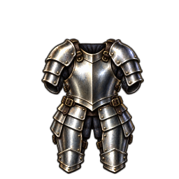 | `plate_mail` |
| 指輪 | 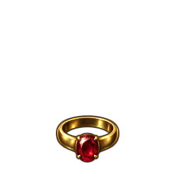 | `ruby__conflict` 小物は元の大きさどおり小さい |
| 護符 | 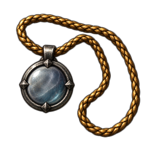 | `circular__amulet_of_esp` |
| 道具 | 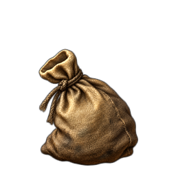 | `bag` 1 枚を袋 4 種で共有 |
| 食べ物 | 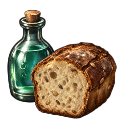 | `food_ration` 元の絵の構図 (パンと瓶) を保つ |
| 薬 | 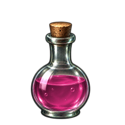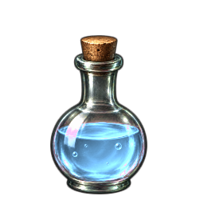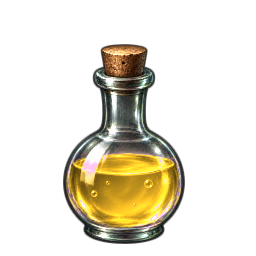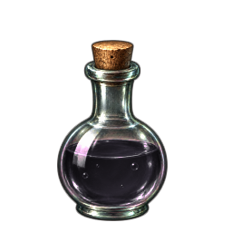 | `potion` 1 枚を 17 色に色替え |
| 巻物 |  | `scroll` 1 枚をラベル 41 種で共有 |
| 魔法書 | 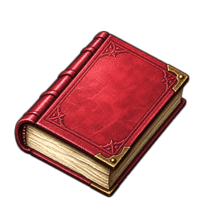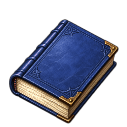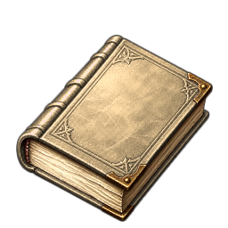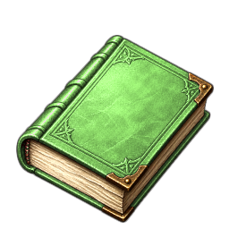 | `spellbook` 1 枚を 19 色に色替え |
| 杖 | 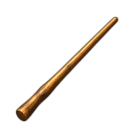 | `oak__nothing` |
| 金貨 | 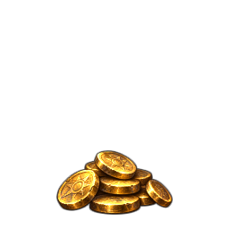 | `gold_piece` |
| 宝石 | 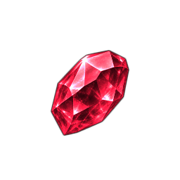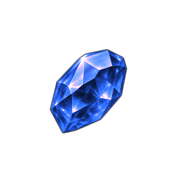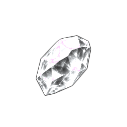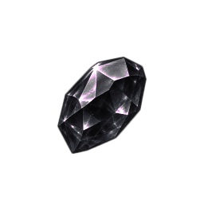 | `gem` 1 枚を 9 色に色替え。同色の宝石とガラス玉は同じ絵 |
| 岩など | 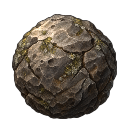 | `boulder` |
| 一般アイコン | 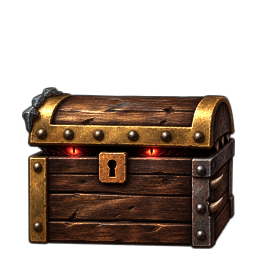 | `strange_object` 元の絵 (ミミックの宝箱) に合わせて目が光る |
